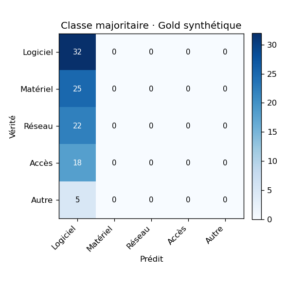
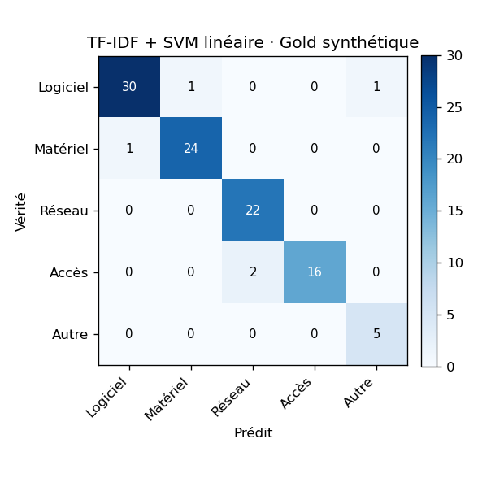
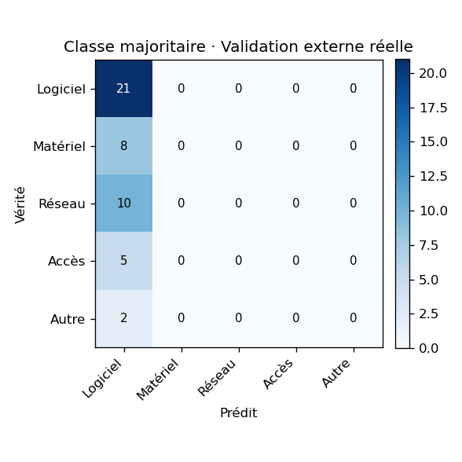
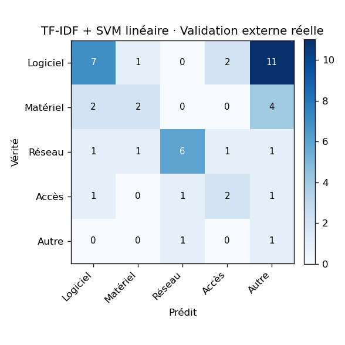

# Harnais d'évaluation — J3 (baselines de classification)

- **Date** : 2026-07-17T18:04:36Z  |  **Seed** : 42  |  **Train** : 852 tickets
- **Gold synthétique** : 102 tickets — source `gold/gold.jsonl`
- **Validation externe réelle** : 46 tickets — source `gold/validation_externe.jsonl`
- **Tâche** : classification de catégorie (catégories dynamiques). Modèles SANS apprentissage (J3) — embeddings+LogReg au J5.

## Étanchéité train / jeux d'éval

- **Gold synthétique** — fuites exactes : **0** ✅ · chevauchements approx. (Jaccard ≥ 0.6) : **8**
- **Validation externe réelle** — fuites exactes : **0** ✅ · chevauchements approx. (Jaccard ≥ 0.6) : **0**

## Tableau comparatif — macro-F1 (métrique de tête)

| Baseline | Gold synthétique (n=102) | Validation externe réelle (n=46) |
|---|---|---|
| Classe majoritaire | **0.096** | **0.125** |
| TF-IDF + SVM linéaire | **0.944** | **0.388** |

_(accuracy et détail par classe ci-dessous ; matrices de confusion en figures.)_

### Accuracy (secondaire)

| Baseline | Gold synthétique | Validation externe réelle |
|---|---|---|
| Classe majoritaire | 0.314 | 0.457 |
| TF-IDF + SVM linéaire | 0.951 | 0.391 |

## Détail par classe — TF-IDF + SVM linéaire · Gold synthétique

| Catégorie | P | R | F1 | support |
|---|---|---|---|---|
| Logiciel | 0.968 | 0.938 | 0.952 | 32 |
| Matériel | 0.960 | 0.960 | 0.960 | 25 |
| Réseau | 0.917 | 1.000 | 0.957 | 22 |
| Accès | 1.000 | 0.889 | 0.941 | 18 |
| Autre | 0.833 | 1.000 | 0.909 | 5 |

## Détail par classe — TF-IDF + SVM linéaire · Validation externe réelle

| Catégorie | P | R | F1 | support |
|---|---|---|---|---|
| Logiciel | 0.636 | 0.333 | 0.438 | 21 |
| Matériel | 0.500 | 0.250 | 0.333 | 8 |
| Réseau | 0.750 | 0.600 | 0.667 | 10 |
| Accès | 0.400 | 0.400 | 0.400 | 5 |
| Autre | 0.056 | 0.500 | 0.100 | 2 |

## Matrices de confusion

### Classe majoritaire · Gold synthétique

### TF-IDF + SVM linéaire · Gold synthétique

### Classe majoritaire · Validation externe réelle

### TF-IDF + SVM linéaire · Validation externe réelle

---
_À venir : retrieval Recall@k/nDCG (J6), priorité kappa pondéré (J7), latence p95 & coût (J4+). Stubs en place dans `eval/`._
