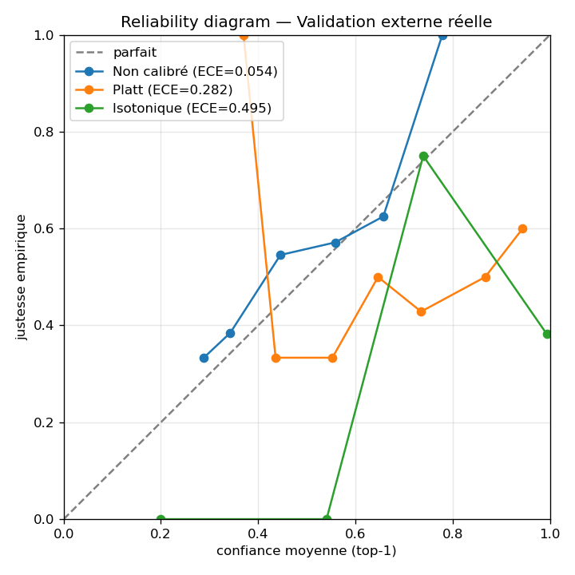
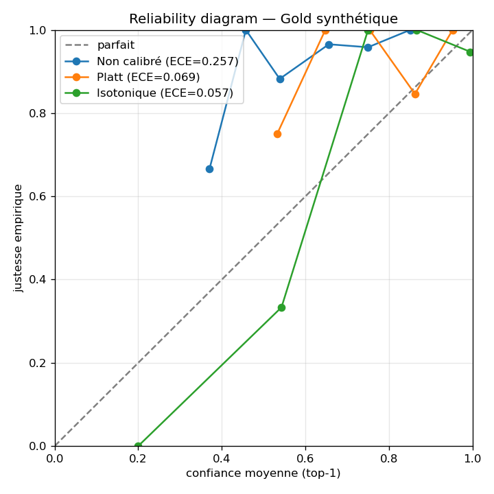
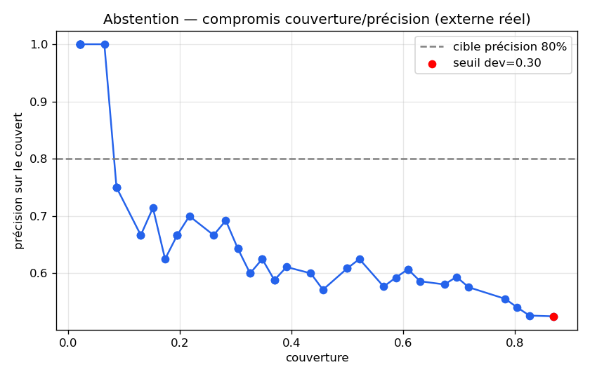
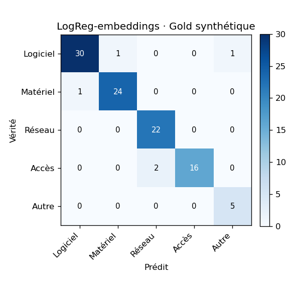
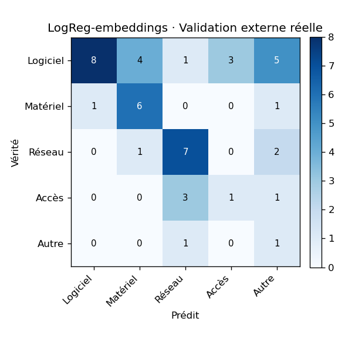

# Harnais d'évaluation — J5 (classification embeddings + calibration)

- **Date** : 2026-07-18T20:43:55Z  |  **Seed** : 42  |  **Embeddings** : `BAAI/bge-m3` (1024d, device cpu)
- **Train** : 852 tickets → split dev stratifié **724 train' / 128 dev** (test_size=0.15)
- **Gold synthétique** : 102 · **Validation externe réelle** : 46
- **Modèle de production figé** : **LogReg-embeddings NON calibrée** (la calibration sur dev synthétique ne transfère pas — voir §Calibration).

## Étanchéité train / jeux d'éval (règle d'or)

- **Gold synthétique** — fuites exactes : **0** ✅ · chevauchements approx. (Jaccard ≥ 0.6) : **8**
- **Validation externe réelle** — fuites exactes : **0** ✅ · chevauchements approx. (Jaccard ≥ 0.6) : **0**

## Écart synthétique → réel — macro-F1 (métrique de tête)

| Modèle | Gold synth. | Externe réel | **écart** | acc réel |
|---|---|---|---|---|
| Classe majoritaire (plancher) | 0.096 | 0.125 | **-0.030** | 0.457 |
| TF-IDF + SVM (J3, réf.) | 0.944 | 0.388 | **0.556** | 0.391 |
| SVM-embeddings (contrôle) | 0.944 | 0.428 | **0.515** | 0.478 |
| LogReg (embeddings bge-m3) | 0.944 | 0.438 | **0.506** | 0.500 |
| LogReg + Platt (preuve) | 0.944 | 0.442 | **0.501** | 0.500 |
| LogReg + isotonique (preuve) | 0.897 | 0.340 | **0.557** | 0.348 |

> **Cible J5** : réduire l'écart (réf. TF-IDF+SVM = 0,556), en remontant le réel via le sémantique multilingue. Le synthétique reste un plafond trompeur.

## Détail par classe — LogReg-embeddings · Validation externe réelle

| Catégorie | P | R | F1 | support |
|---|---|---|---|---|
| Logiciel | 0.889 | 0.381 | 0.533 | 21 |
| Matériel | 0.545 | 0.750 | 0.632 | 8 |
| Réseau | 0.583 | 0.700 | 0.636 | 10 |
| Accès | 0.250 | 0.200 | 0.222 | 5 |
| Autre | 0.100 | 0.500 | 0.167 | 2 |

## Calibration — ECE (la calibration synthétique ne transfère pas)

| Variante | ECE synth. | ECE réel |
|---|---|---|
| Non calibré | 0.257 | 0.054 |
| Platt | 0.069 | 0.282 |
| Isotonique | 0.057 | 0.495 |

_Calibrer sur le dev **synthétique** améliore l'ECE synthétique mais **dégrade** l'ECE réel : la variante **non calibrée** est la mieux calibrée sur le vrai. → modèle de production non calibré ; vraie calibration = flywheel J9 (dev réel)._

## Abstention — seuil réglé sur dev, appliqué au test

- Seuil qui atteint précision ≥ 80% **sur le dev** : **0.300** (dev : couverture 100%, précision 96%).
- Appliqué au **gold synth.** : couverture 100%, précision 95%.
- Appliqué à l'**externe réel** : couverture 87%, précision 52%.

_Le dev synthétique est trop facile (précision 96%) → le seuil descend au plancher → **~0 abstention utile** sur le réel. Le mécanisme existe (§6.5, seuil admin paramétrable) mais **n'est pas figé** : son réglage exige un dev réel (J9)._

## Matrices de confusion — LogReg-embeddings

### Gold synthétique

### Validation externe réelle

---
## Fil rouge — la limite synthétique→réel se propage à trois niveaux

1. **Classification** (J3) : 0,944 → 0,388.
2. **Calibration** (J5) : calibrer sur synthétique dégrade l'ECE réel (0.054 → 0.282).
3. **Abstention** (J5) : un seuil réglé sur synthétique = ~0 abstention utile sur le réel.

Les embeddings sémantiques **réduisent** l'écart de classification (0,556 → 0.506, accuracy réelle 0,391 → 0.500, repasse au-dessus du plancher) mais **ne le comblent pas**. Enseignement central : le corpus synthétique est un plafond trompeur à tous les niveaux ; seul le flywheel sur données réelles (J9) peut combler l'écart.

_À venir : retrieval Recall@k/nDCG (J6), priorité kappa pondéré (J7), abstention calibrée sur dev réel (J8/J9)._
