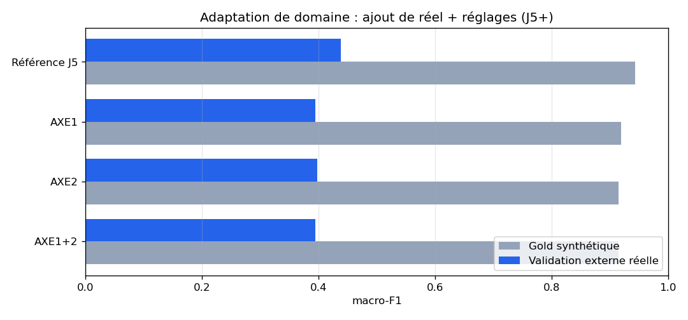

# J5+ — Adaptation de domaine (réel à l'entraînement + réglages)

- **Date** : 2026-07-19T20:43:10Z  |  **Seed** : 42  |  **Embeddings** : `BAAI/bge-m3`
- **Train synth.** : 852 → 724 train' / 128 dev  |  **Réel ajouté** : 242  |  Test : gold 102 + externe 46
- **Étanchéité réel-train** — vs externe : exact **0** / approx 0 · vs gold : exact **0** / approx 0

## Règle d'interprétation (pré-enregistrée, avant résultats)

- gain réel **> +0.05** → effet solide → AXE1 production + section adaptation
- **+0.02 .. +0.05** → ambigu → perspective, production inchangée
- **< +0.02** ou négatif → pas d'effet exploitable → J5 conservé

## Tableau comparatif — macro-F1

| Configuration | Entraînement | Gold synth. | Externe réel | écart | Δréel vs réf. |
|---|---|---|---|---|---|
| Référence J5 (synth, C=1.0) | synthétique 724 | 0.944 | 0.438 | 0.506 | +0.000 |
| AXE1 (synth + réel) | synth 724 + réel 242 | 0.919 | 0.395 | 0.524 | -0.043 |
| AXE2 (synth, C=1.0, cw=balanced) | synthétique 724 | 0.915 | 0.397 | 0.518 | -0.041 |
| AXE1+2 (synth + réel, C=1.0, cw=balanced) | synth 724 + réel 242 | 0.915 | 0.395 | 0.521 | -0.043 |

## Sélection d'hyperparamètres au dev synthétique (AXE2)

- **synth seul** → C=1.0, cw=balanced (dev macro-F1 0.970)
- **synth + réel** → C=1.0, cw=balanced (dev macro-F1 0.991)

_Dev synthétique = sélecteur imparfait (souvent saturé), mais seul légitime (gold/externe = test pur)._

## Verdict

- **gain réel AXE1** = **-0.043**  |  AXE1+2 = -0.043
- **NUL/NÉGATIF (<+0.02) → J5 conservé, AXE1 en perspective**

> Étiquetage réel : automatique (entités + tags + mots-clés), qualité mesurée par spot-check r1 53/70 % → r2 (après corrections) **73/87 %**. Erreur résiduelle : les tags `Account*` sur-déclenchent `Accès` sur cloud/facturation (corrigeable, non corrigée — itération unique convenue). Étanchéité renforcée Jaccard **0.5** (< 0.6 standard), justif. : source commune train/test.
