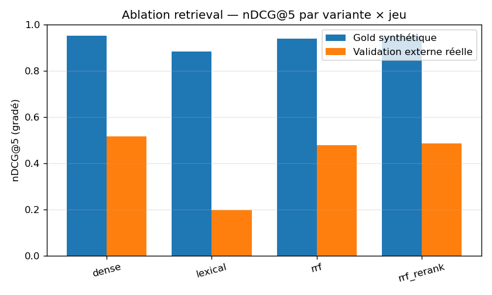

# Ablation retrieval — clôture J6 (dense / lexical / RRF / +rerank)

- **Date** : 2026-07-27T20:18:41Z  |  **Juge** : qwen2.5:14b (validé κ_w 0,954 vs humain)  |  **Jugements** : 1486 (cache)
- **Gold synthétique** : 102 requêtes — pool jugé profond 5–16 (couverture top-5 = 100.0%)
- **Validation externe réelle** : 46 requêtes — pool jugé profond 8–15 (couverture top-5 = 98.5%)
- **Métriques** : pooling façon TREC, pertinent = grade ≥ 1 (strict grade = 2 en second). Config retrieval **gelée** (`retrieval/config.py`), jamais réglée sur le gold.

- **Anti-fuite** (le doc retrouvé ≠ la requête) : **0** fuite(s) exacte(s), 7 proche(s) signalé(s).

## nDCG@5 (ordre gradé — métrique de tête pour le rerank)

| Variante | Gold synthétique (n=102) | Validation externe réelle (n=46) |
|---|---|---|
| dense | **0.953** | **0.518** |
| lexical | **0.885** | **0.196** |
| rrf | **0.940** | **0.478** |
| rrf_rerank | **0.951** | **0.487** |

## Recall@5

| Variante | Gold synthétique (n=102) | Validation externe réelle (n=46) |
|---|---|---|
| dense | **0.606** | **0.520** |
| lexical | **0.588** | **0.177** |
| rrf | **0.605** | **0.512** |
| rrf_rerank | **0.606** | **0.534** |

## MRR

| Variante | Gold synthétique (n=102) | Validation externe réelle (n=46) |
|---|---|---|
| dense | **0.995** | **0.589** |
| lexical | **0.985** | **0.277** |
| rrf | **0.995** | **0.615** |
| rrf_rerank | **0.993** | **0.555** |

## Verdict — le rerank réordonne-t-il pour le mieux ? (Δ = rrf_rerank − rrf)

| Métrique | Gold synthétique | Validation externe réelle |
|---|---|---|
| ndcg@5 | +0.011 | +0.009 |
| recall@5 | +0.002 | +0.023 |
| mrr | -0.002 | -0.060 |

_Un Δ positif = le rerank améliore l'ordre ; négatif = il le dégrade._

## Figure

---
_Décision de production (`retrieval/config.py`) : `RERANK_ACTIF_DEFAUT=False` — l'ordre d'affichage reste **RRF** ; le reranker ne sert qu'au **score** de la porte d'abstention (top-1). Le réentraînement du reranker attend le flywheel J9._
