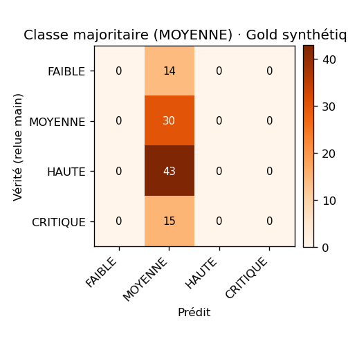
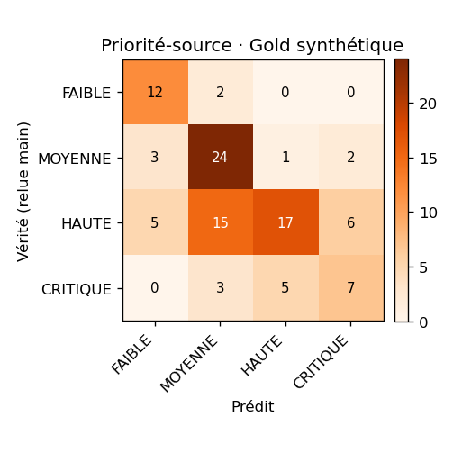
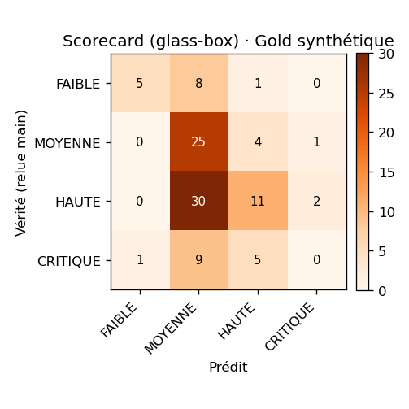
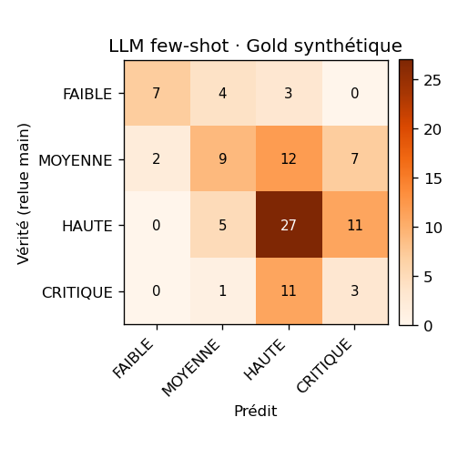
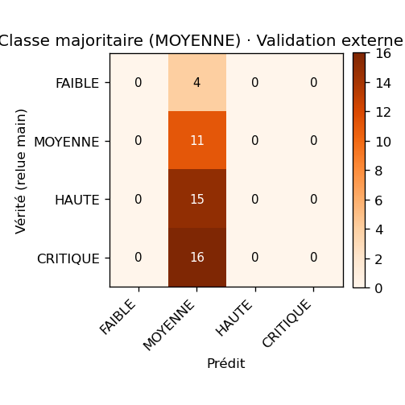
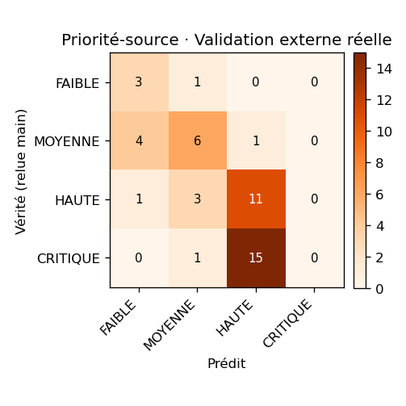
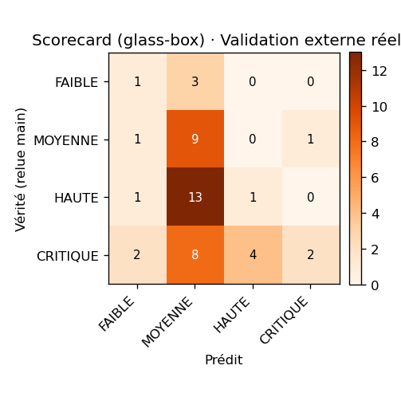
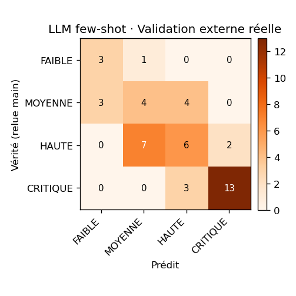

# Harnais d'évaluation — J7 (priorisation glass-box)

- **Date** : 2026-07-27T00:03:01Z  |  **Déterministe** (aucun seed ; LLM temp 0)
- **Gold synthétique** : 102 tickets — source `gold/gold.jsonl`
- **Validation externe réelle** : 46 tickets — source `gold/validation_externe.jsonl`
- **Tâche** : priorité ordinale (FAIBLE < MOYENNE < HAUTE < CRITIQUE). Métrique de tête : **κ pondéré quadratique** (accord avec les labels relus main).

> **Pré-enregistrement (anti-contamination)** : poids ET seuils du scorecard sont **gelés a priori** (`priority/lexicon.py`), issus de justifications métier, **jamais optimisés** sur le gold ou l'externe (ce sont les TESTS). Le scorecard reçoit la **vraie catégorie** (isole la priorité de l'erreur du classifieur J5). Un κ modéré est un résultat honnête, pas une invitation à trafiquer les seuils.

## Étanchéité train / jeux d'éval

- **Gold synthétique** — fuites exactes : **0** ✅ · approx. (Jaccard ≥ 0.6) : **8**
- **Validation externe réelle** — fuites exactes : **0** ✅ · approx. (Jaccard ≥ 0.6) : **0**

## Tableau comparatif — κ pondéré quadratique (métrique de tête)

| Prédicteur | Gold synthétique (n=102) | Validation externe réelle (n=46) | **Écart synth→réel** |
|---|---|---|---|
| Classe majoritaire (MOYENNE) | **0.000** | **0.000** | +0.000 |
| Priorité-source | **0.604** | **0.612** | -0.008 |
| Scorecard (glass-box) | **0.226** | **0.158** | +0.068 |
| LLM few-shot | **0.456** | **0.785** | -0.329 |

_L'écart (synthétique − réel) répond à la question du fil rouge : un prédicteur qui transfère a un écart proche de 0._

### Accuracy à ±1 cran (secondaire)

| Prédicteur | Gold synthétique | Validation externe réelle |
|---|---|---|
| Classe majoritaire (MOYENNE) | 0.853 | 0.652 |
| Priorité-source | 0.902 | 0.957 |
| Scorecard (glass-box) | 0.882 | 0.739 |
| LLM few-shot | 0.892 | 1.000 |

### Accuracy exacte (secondaire)

| Prédicteur | Gold synthétique | Validation externe réelle |
|---|---|---|
| Classe majoritaire (MOYENNE) | 0.294 | 0.239 |
| Priorité-source | 0.588 | 0.435 |
| Scorecard (glass-box) | 0.402 | 0.283 |
| LLM few-shot | 0.451 | 0.565 |

## Analyse de sensibilité — décalage des seuils (robustesse)

_Seuils gelés à `1.0 / 2.5 / 4.0`. On les translate de ±1 pour montrer que le κ du scorecard n'est pas un artefact de seuil (décalage 0.0 = config gelée)._

| Décalage seuils | Gold synthétique | Validation externe réelle |
|---|---|---|
| -1.0 | 0.279 | 0.289 |
| -0.5 | 0.173 | 0.275 |
| +0.0 ← gelé | 0.226 | 0.158 |
| +0.5 | 0.158 | 0.142 |
| +1.0 | 0.066 | 0.120 |

## Décomposition explicable (exemples fictifs)

_La sortie du scorecard n'est pas qu'un niveau : c'est une justification facteur par facteur — l'exigence glass-box §6.5._

- « Petite coquille dans le libellé du menu » (Logiciel) → **FAIBLE car : Logiciel (+1.00) · coquille (−1.00)** — score 0.00
- « Outlook lent depuis ce matin, c'est urgent » (Logiciel) → **MOYENNE car : Logiciel (+1.00) · urgent (+0.50)** — score 1.50
- « Impossible de me connecter à mon compte » (Accès) → **HAUTE car : Accès (+1.50) · bloque (+1.00)** — score 2.50
- « Serveur de fichiers down, tout le service bloqué » (Réseau) → **CRITIQUE (plafonné) car : production (+2.00) · en production (+2.00) · tout le service (+2.00) · Réseau (+1.50) · bloque (+1.00)** — score 7.50

## Ancienneté / SLA — re-priorisation (démo qualitative, hors κ)

_Gold/réel = jugements à la création (age=0) → le terme SLA est **nul** à l'éval. En production, un ticket **monte** en priorité en vieillissant :_

- « Imprimante d'étage en panne » (Matériel) :
    - à    0 h → **MOYENNE** (score 2.00)
    - à   30 h → **HAUTE** (score 3.00)
    - à   60 h → **CRITIQUE** (score 4.00)

## Matrices de confusion (vérité × prédit)

### Classe majoritaire (MOYENNE) · Gold synthétique

### Priorité-source · Gold synthétique

### Scorecard (glass-box) · Gold synthétique

### LLM few-shot · Gold synthétique

### Classe majoritaire (MOYENNE) · Validation externe réelle

### Priorité-source · Validation externe réelle

### Scorecard (glass-box) · Validation externe réelle

### LLM few-shot · Validation externe réelle

---
_Poids/seuils exposables en paramètres admin (§6.5) ; réglage sur données réelles délégué au flywheel J9. Le scorecard reste une **règle explicite**, non un classifieur appris._
